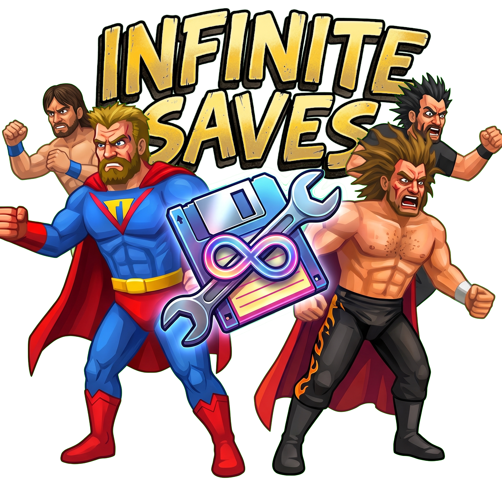

<div align="center">
  

  <h1>Infinite Saves</h1>

  <p>Universal In-Browser Save File Editor for MDickie's <em>Infinite Lives</em></p>

  <p>
    <a href="https://react.dev"></a>
    <a href="https://vite.dev"></a>
    <a href="https://tailwindcss.com"></a>
    <a href="https://oxc.rs"></a>
    <a href="https://nodejs.org"></a>
    
    
    <a href="LICENSE"></a>
    <a href="https://github.com"></a>
  </p>

  <p>
    <a href="#key-features">Key Features</a> &bull;
    <a href="#supported-file-formats--workflows">Supported Workflows</a> &bull;
    <a href="#technical-superpower-reference">Power Reference</a> &bull;
    <a href="#project-structure">Project Structure</a> &bull;
    <a href="#getting-started">Getting Started</a> &bull;
    <a href="#save-file-safety-precautions">Safety Precautions</a>
  </p>
</div>

---

## Key Features

- **Direct Native Binary Parsing (`Save.bytes`)**: Decodes .NET BinaryFormatter (NRBF) structures in-place inside the browser using `ArrayBuffer` and `DataView`. Exports byte-for-byte patched binary files directly without re-encoding failures.
- **Decompiled JSON & Text Compatibility**: Seamlessly loads and writes decompiled JSON save exports (`Original_Save.txt`, `Modified_Save.txt`, `.json`) compatible with third-party tools such as saveeditonline.com.
- **Dual Roster Support**: Full switching and cross-inspection between active live campaign characters (`savedChars`) and Time Machine snapshot records (`timeChars`).
- **Deep Superpower Editing**: Complete mapping for all 8 core power categories, including attack powers, limb emitters, movement styles, crafting, innate abilities, grapple moves, telekinesis, alter-ego transformations, and weaknesses.
- **Power Cloning**: One-click extraction and replication of pristine superpower configurations from a character's Time Machine profile into their active session persona.
- **Archetype Presets**: Instant loadout application for proven comic book archetypes (Titan / Kryptonian, Speedster, Telekinetic God, Pyromancer, Arsenal Weapon Master, and Default Mortal).
- **Vitals & Roster Attributes**: Fine-grained modification of health, maximum health limits, spirit / adrenaline, injury states, mortality flags, roles, factions / teams, demeanour, and voice indices.
- **Audit Logging & Granular Undo**: Comprehensive session transaction history that records every attribute diff with timestamps, enabling single-mutation rollbacks or complete session reverts.
- **Side-by-Side Comparison**: Visual differential comparison modal between current live values, original session values, and Time Machine baseline configurations.

---

## Supported File Formats & Workflows

### 1. Direct Binary Workflow (Recommended)

```
[Game Save Location]
        │
        ▼ (Copy Save.bytes)
[Infinite Saves Web UI]
   - Drop Save.bytes directly into browser
   - In-memory parsing via NRBF parser
   - Edit powers, vitals, teams, and presets
   - Click "Export Save.bytes"
        │
        ▼ (In-place binary byte patch)
[Save-modified.bytes]
        │
        ▼ (Rename to Save.bytes & inject into game)
[Game Ready to Play]
```

### 2. Decompiled Text / JSON Workflow

```
[Save.bytes]
        │ (Decompile via saveeditonline.com)
        ▼
[Original_Save.txt] (10MB JSON)
        │
        ▼
[Infinite Saves Web UI]
   - Edit values visually
   - Click "Export JSON"
        │
        ▼
[Modified_Save.txt]
        │ (Recompile via saveeditonline.com)
        ▼
[Save.bytes] -> Inject into Game
```

---

## Technical Superpower Reference

### Internal Save IDs vs In-Game Dropdown Indexes

MDickie game engines maintain a distinct separation between internal data IDs and presentation indexes:

1. **Internal Save File ID**: The raw signed 32-bit integer read by the game runtime (e.g., `powerAttack = 12` executes Rockets).
2. **In-Game Dropdown Index**: The position in the in-game editor menu. In-game menus sort powers alphabetically (e.g., Rockets appears as item #26 in the dropdown, but is stored internally as ID `12`).
3. **Power Sliders**: Independent in-game multipliers governing projectile velocity, damage radius, and burst frequency.

### Signed Integer Compound Conventions

Certain power fields utilize signed integers to enable combined mechanic sets:

| Field         | Value | Effect                           |
| :------------ | :---- | :------------------------------- |
| `powerFlight` | `1`   | Default running speed            |
| `powerFlight` | `-4`  | Flight + Speed Boost combination |
| `powerFlight` | `55`  | Super Speed Sprint               |
| `powerFlight` | `-55` | Super Speed + Flight combination |
| `powerCraft`  | `4`   | Duplication                      |
| `powerCraft`  | `-4`  | Attraction + Duplication hybrid  |
| `transform`   | `55`  | Random Alter-Ego                 |
| `transform`   | `69`  | Permanent Alter-Ego              |

### Projectile Limb Mapping

The `projectileLimb` attribute is structured as an array of 3 integer slots (`0`, `1`, `2`):

- `0`: Disabled / None
- `1`: Eyes / Head
- `2`: Mouth / Breath
- `3`: Palms / Hands
- `4`: Feet
- `5`: Torso / Chest (Chest Beams)

The editor automatically maintains symmetrical assignments across all three slots unless custom slot allocation is required.

---

## Project Structure

```
website/
├── public/
│   ├── favicon.svg            # Minimalist vector application icon
│   ├── favicon.png            # Raster application icon
│   ├── logo.png               # High-resolution application brand mark
│   └── Save-template.bytes    # Blank baseline save template
├── src/
│   ├── assets/                # Static visual assets and brand marks
│   ├── components/
│   │   ├── AuditLogModal.jsx  # Change history drawer and rollback controls
│   │   ├── CharacterEditor.jsx# Character sheet editor (powers, vitals, allegiances)
│   │   ├── CharacterList.jsx  # Searchable roster listing with filter tabs
│   │   ├── CompareModal.jsx   # Side-by-side diff against original / Time Machine
│   │   ├── GuideModal.jsx     # In-app reference for IDs, signs, and limbs
│   │   ├── Header.jsx         # Action bar (file input, export, theme toggle)
│   │   ├── Icons.jsx          # Monochromatic SVG icon catalog
│   │   └── PresetModal.jsx    # Hero archetype selector modal
│   ├── constants/
│   │   └── powers.js          # Reverse-engineered power ID catalog and presets
│   ├── hooks/
│   │   └── useTheme.js        # Theme management with system preference listener
│   ├── utils/
│   │   └── saveBytes.js       # NRBF binary parser and byte-patching engine
│   ├── App.jsx                # Main application state and file coordinator
│   ├── index.css              # Baseline typography and design system tokens
│   └── main.jsx               # React DOM entrypoint
├── index.html                 # Single page root with theme pre-hydration script
├── package.json               # Node module manifests and execution scripts
├── vite.config.js             # Vite 8 configuration with Tailwind CSS v4
└── README.md                  # Project documentation
```

---

## Getting Started

### Prerequisites

- **Node.js**: Version 18.0.0 or higher
- **npm** or **pnpm** package manager

### Installation

Clone the repository and install dependencies from the `website` root:

```bash
cd website
npm install
```

### Development Server

Start the local Vite development server with Hot Module Replacement (HMR):

```bash
npm run dev
```

Open `http://localhost:5173` in your browser.

### Production Build

Compile the production-ready assets into the `dist/` directory:

```bash
npm run build
```

To preview the production bundle locally:

```bash
npm run preview
```

### Linting

Run Oxlint to check code quality:

```bash
npm run lint
```

---

## Save File Safety Precautions

1. **Always Maintain Backups**: Before editing or patching any save file, create a dedicated copy of your original `Save.bytes` file in a safe location.
2. **Quit the Game Before Injecting**: Ensure _Infinite Lives_ is fully closed before overwriting the active save file on your device to prevent operating system file lock conflicts or save corruption.
3. **Save Locations**:
   - **Windows / Steam**: `%USERPROFILE%/AppData/LocalLow/MDickie/Infinite Lives/Save.bytes`
   - **Android**: `/Android/data/com.MDickie.InfiniteLives/files/Save.bytes` (or via device file manager / USB transfer)

---

## Tech Stack

- **React 19**: Modern component architecture with reactive hooks and memoized state.
- **Vite 8**: High-speed bundler and dev server.
- **Tailwind CSS v4**: Utility-first CSS engine with strict typography and surface tokens.
- **Oxlint**: High-performance JavaScript/JSX linter.
- **Native Binary Utilities**: In-browser TypedArrays (`Uint8Array`, `DataView`, `ArrayBuffer`) for binary serialization.

---

## Disclaimer

This utility is an independent reverse-engineering project created for research, backup, and single-player modding purposes._Infinite Lives_, and all related character names, assets, and trademarks are the property of Mat Dickie (MDickie). This project is not affiliated with, endorsed by, or sponsored by MDickie.
